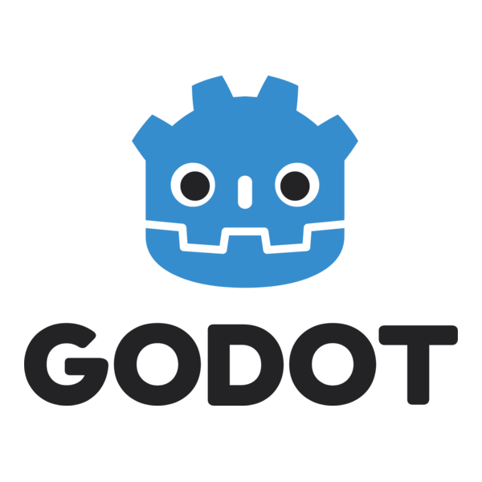

## El personaje

Vamos a configurar el caracter del personaje y colocar todo lo necesario en su lugar.

### Creando el nodo

Crearemos el nodo raíz para nuestro personaje. Este nodo será un `CharacterBody2D` que pondremos, de momento, como hijo del `Principal` y le llamaremos `Personaje`.

En el *Inspector* de Godot cambiaremos la propiedad *Motion Mode* de este nodo de `Grounded` a `Floating`, para asegurar que los cálculos necesarios para su movimiento sean exactos.

### Agregando el *sprite*

Con `Personaje` seleccionado, agregamos un nodo hijo del tipo `Sprite2D`, que dejaremos con el nombre `Sprite` simplemente.

En el campo que pone `<vacío>` de su propiedad *Texture* le arrastraremos el archivo `People.png` que se encuentra en la carpeta de `Visuales`.

Lo que este archivo contiene es todo un mosaico de personajes. Pero antes de seleccionar alguno, debemos asegurarnos que Godot muestre los sprites de manera nítida. Para ello nos vamos a *Proyecto -> Configuración del Proyecto* y nos quedamos en la pestaña *General*. Ubicamos la categoría *Renderizado* y en su sección *Textura del Canvas* cambiamos la propiedad *Filtro de Textura Predeterminado* a `Nearest`. Ya deberían verse bien nuestros personajes. Damos clic en *Cerrar*.

### Seleccionando la región del sprite

Podemos notar que el sprite contiene demasiadas cosas, pero solo necesitamos un personaje. Para seleccionar solo un área determinada, podemos activar la opción `Region` y luego damos clic en el botón *Editar Región*.

Esto nos permitirá seleccionar la región que nos interesa, aunque podemos facilitarlo si cambiamos el *Modo de ajuste* a `Ajuste de píxeles`.

### Agregando la forma de colisión

Hacemos un buen zoom para poder ver claramente nuestro personaje. Enseguida seleccionamos el nodo `Personaje` y agregamos un nodo `CollisionShape2D` como su hijo.

En la propiedad *Shape* seleccionamos `CapsuleShape` y la ajustamos de manera que coincida con el sprite.

## El arma

Nuestro personaje tendrá un arma que el jugador podrá apuntar usando el cursor del ratón. Vamos a crearla.

### Configurando el arma y su sprite

Seleccionamos `Personaje` y le agregamos un nodo `Node2D` como hijo. Le renombraremos como `Arma`.

Seleccionamos `Arma` y le anidamos un nodo `Sprite2D` que renombramos como `SpriteArma`.

En la textura de este último nodo de sprite cargamos el archivo alusivo a las arma en nuestra carpeta de `Visuales` (`Weapons.png`) y repetimos el mismo proceso de selección de región que usamos con el personaje. En este ejemplo, usamos una varita como arma.

Podemos presionar el icono de un ojo al lado del sprite del personaje para ocultarlo temporalmente y facilitarnos el proceso de selección del sprite de arma adecuado. No olvidemos habilitarlo después.

Toca rotar el arma para que quede apuntando hacia arriba y moverla para que dé la impresión de que el personaje la está sujetando. No olvidemos que podemos presionar  para transformar los sprites de manera más precisa.

### Creando el "cañón" del arma

Con esto nos referimos al punto en donde aparecerán los proyectiles del arma.

Vamos a anidar dentro de `Arma` un nodo `Node2D` y lo renombraremos como `Cannon`.

Lo posicionaremos de manera que se encuentre en el punto donde consideramos que deba ser el cañón de nuestra arma.

## La cámara

Para poder ver a nuestro personaje necesitamos una cámara. La agregamos al nodo `Principal` como un nodo de tipo `Camera2D`. En su propiedad *Zoom* que se encuentra en la sección *Camera2D* cambiamos ambos valores (de *x* y *y*) a `4.0`.

Ahora ya podemos presionar la tecla  y podremos ver nuestro personaje en pantalla, aunque en realidad no haga nada, por ahora.

En la siguiente entrada programaremos los movimientos del caracter.
